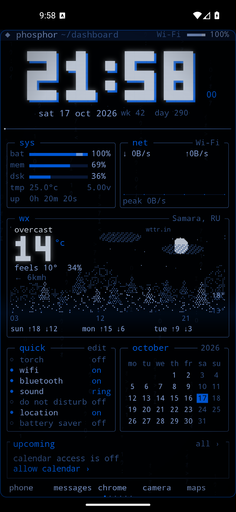
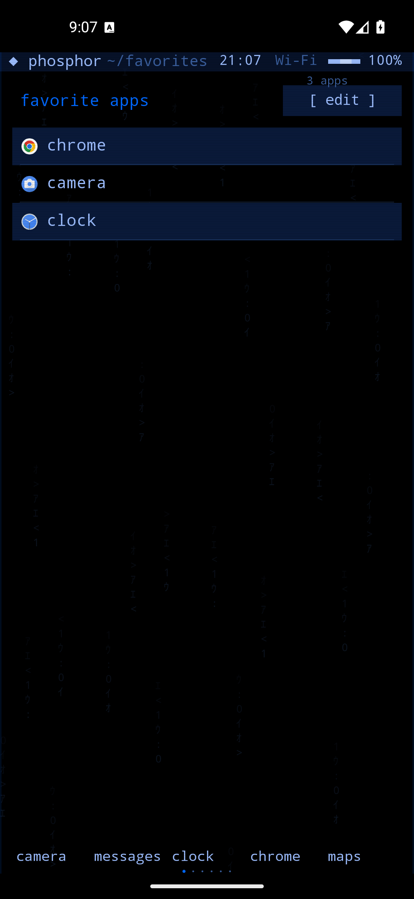
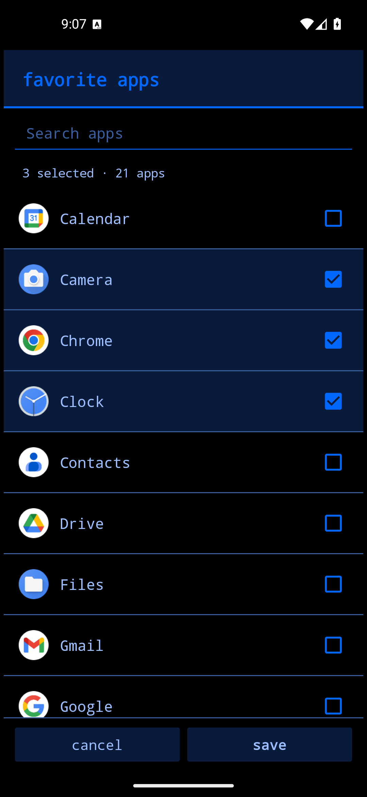
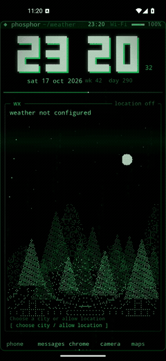
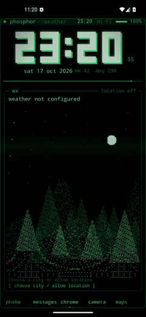
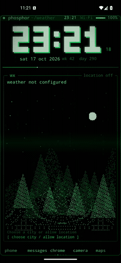

# Phosphor Demake

Неофициальный Android-лаунчер в терминальном CRT-стиле, вдохновлённый [Phosphor](https://phosphor.zanoski.com/). Нативный интерфейс на Kotlin / Android Canvas, настраиваемые страницы и офлайн-арт из [ascii.rest](https://ascii.rest/).

**[Скачать APK](https://github.com/Arkuda/phosphor_demake/releases/latest/download/app-debug.apk)** · [Все релизы](https://github.com/Arkuda/phosphor_demake/releases) · [История изменений](CHANGELOG.md)

## Скриншоты

<p align="center">
  
  
  
</p>

Снимки работающего приложения в Android-эмуляторе, не макеты. На главном экране — реальный прогноз Самары из wttr.in; доступ к календарю не включён. Также: [погода на настоящем локскрине, включая офлайн-кэш](captures/weather-lock-shared-cache.png), [выровненная сетка месяца](captures/calendar-aligned-normal.png), [события календаря](captures/dashboard-final.png), [список приложений](captures/apps-updated.png), [арт ascii.rest на Zen](captures/ascii-zen.png).

Изменения 1.4: [короткий диалог на 720×1280](captures/weather-dialog-compact-fit-1.4.png), [главная без рамок с переименованным приложением в доке](captures/frameless-matrix-main-1.4.png), [настоящий локскрин без рамок](captures/frameless-keyguard-1.4.png).

## Анимации переключения

<p align="center">
  
  
  
</p>

Слева направо: **CRT beam**, **terminal slide**, **Matrix scan**. Реальные записи приложения; системная настройка замедляет переходы в три раза, чтобы эффект был виден. [Выбор всех четырёх режимов на компактном экране](captures/animation-selector-compact-1.5.png).

## Возможности

- Блочные часы с мигающим двоеточием, смещённой тенью и секундами. Усиленный CRT: скан-линии, фосфорная сетка, мягкая проходящая полоса, виньетка и стеклянная рамка; без резких вспышек. Эффект выключается через **CRT glass**; 14 цветовых тем.
- До 10 настраиваемых страниц: dashboard, избранное, погода, уведомления, системный монитор, Zen, art, календарь, медиа и инструменты.
- Три настраиваемых перехода между страницами: **CRT beam**, **terminal slide**, **Matrix scan**; **off · instant** переключает без анимации. Арт ascii.rest движется вместе со страницей; отключение системных анимаций учитывается.
- Переключатель **widget frames** убирает рамки виджетов и внешний CRT-контур, не отключая скан-линии и остальные эффекты.
- Список установленных приложений с иконками размером с текст, инерционной прокруткой, поиском с поддержкой опечаток и запуском приложений.
- Пять упорядоченных позиций нижнего бара: выбор приложения для каждой позиции, собственные подписи, пустые позиции, перестановка без дубликатов и сохранение настроек.
- Отдельная страница **favorites**: выбранные приложения сохраняются независимо от нижнего бара; быстрый запуск, поиск, инерционная прокрутка и добавление/удаление через долгое нажатие.
- Диалоги с выделенными заголовками, разделителями и высотой по содержимому: короткие меню помещаются полностью, длинные прокручиваются при нехватке места. В выборе приложения — только название и иконка, поиск без учёта регистра, явное отсутствие результатов; выбор нескольких приложений сохраняется при смене поискового запроса.
- Ближайшие события календаря на главной и общий виджет на существующей странице **agenda**: текущие, будущие и события на весь день; завершённые, отменённые и скрытые события не показываются.
- Сетка месяца на **today** и главном экране: центрированные колонки дней недели и дат, выровненное выделение текущего дня; раскладка учитывает четыре, пять или шесть недель и размер текста.
- Погода Open-Meteo с резервным источником **wttr.in** при недоступности сервера прогноза; кириллический поиск города, уточнение страны, трёхдневный прогноз и локальный кэш.
- Реальные показатели батареи, памяти, хранилища и сетевого трафика; быстрые системные действия.
- Необязательный доступ к уведомлениям, календарю и управлению медиа.
- Задачи, заметки, калькулятор, Pomodoro с фоновыми сигналами, мировые часы и другие инструменты.
- **217 работ ascii.rest 0.4.0 внутри APK:** категории, поиск, оригинальные цвета или палитра лаунчера, пауза. Отдельная страница art и замена пейзажа на Zen. Интернет для арта не нужен.
- Живые обои для домашнего экрана / экрана блокировки через системный выбор Android. Погода использует общий город и кэш с главным экраном, подхватывает изменения и обновляется при возвращении к существующему локскрину; сохранённый прогноз доступен без сети.

## Установка и управление

1. Скачайте APK из [Releases](https://github.com/Arkuda/phosphor_demake/releases/latest) и разрешите установку из выбранного источника. Публикуемый APK — debug-сборка.
2. Откройте Phosphor → **◆ phosphor → set default launcher**, чтобы назначить его домашним экраном.
3. При необходимости включите доступ в **optional permissions** и настройте город в **weather / location**. Эти разрешения не обязательны для запуска лаунчера.

Жесты: **вверх** — приложения, **вниз** — системная шторка, **влево / вправо** — страницы. Долгое нажатие на свободную область открывает редактирование страниц; на приложение — закрепление в нижнем баре, добавление/удаление из избранного, информацию и удаление приложения.

Переключение страниц: **◆ phosphor → page animation**. Выберите сжатие в CRT-строку, терминальный сдвиг, Matrix-развёртку или **off · instant** для мгновенного переключения. Выбор сохраняется после перезапуска; по умолчанию используется **CRT beam**. В энергосбережении эффекты короче; при выключенных системных анимациях переключение всегда мгновенное. Настройка не отключает фоновые CRT-эффекты и мигание часов.

Нижний бар: **◆ phosphor → dock apps** → позиция. Для занятой позиции доступны **choose app**, **rename label** и **empty slot**; пустая сразу открывает выбор приложения. Долгое нажатие на позицию открывает то же меню. **rename label → save** меняет только подпись в доке, сохраняя регистр; пустое поле возвращает стандартное имя. Общий список, избранное и запуск приложения не меняются. Если приложение уже есть в баре, позиции меняются местами, а собственная подпись следует за приложением. Удалённое приложение оставляет пустую позицию. **reset to defaults** восстанавливает начальный набор и стандартные подписи.

Избранное: **◆ phosphor → open favorites → [ edit ]** → отметьте приложения → **save**. **cancel** не применяет изменения; поиск не сбрасывает отметки. Чтобы страница постоянно была среди экранов, откройте **pages → add page → favorites**. Долгое нажатие на приложение в общем списке или избранном позволяет добавить/убрать его без изменения дока.

Рамки: **◆ phosphor → widget frames**. Настройка общая для главной, отдельных страниц и живых обоев; применяется к уже работающему локскрину. Заголовки, разделители, выделение текущей даты и элементы выбора остаются. **CRT glass** независимо управляет остальным CRT-эффектом.

События: разрешите чтение календаря в **optional permissions → calendar events** или прямо в виджете. **all ›** на главной и **◆ phosphor → calendar events** открывают существующий экран **agenda**; его также можно выбрать в редакторе страниц. Уведомления остаются на отдельной странице **inbox**.

Погода для Самары: **◆ phosphor → weather / location → choose city** → `Самара, РФ`, `Самара, RU` или `Samara, RU`. Геокодирование учитывает язык ввода и страну; используется часовой пояс выбранного города, для Самары — `Europe/Samara`. Название источника видно в виджете. При переходе на wttr.in график показывает исходные трёхчасовые точки ближайших 24 часов, без выдуманной почасовой интерполяции.

Погоду для локскрина отдельно настраивать не нужно: он использует тот же прогноз. При загрузке, отключённой погоде или ошибке показывается соответствующее состояние, а не ложное «weather not configured».

Арт: **◆ phosphor → ASCII art**. Выберите **browse catalogue**, **open art page** или переключите **Zen scene**. Страницу art также можно добавить через редактор страниц.

Для композиции экрана блокировки выберите компактные системные часы в настройках Android. Приложение не может перемещать или заменять часы, нарисованные самой системой; большие двухстрочные часы могут перекрывать живые обои.

## Требования и сборка

- Android **8.0 / API 26+**; для арта — актуальный Android System WebView.
- Для сборки: **JDK 17**, Android SDK Platform **35**. Укажите SDK через `ANDROID_HOME` или локальный `local.properties` с `sdk.dir`.

Windows:

```powershell
.\gradlew.bat :app:assembleDebug
```

Linux / macOS:

```sh
./gradlew :app:assembleDebug
```

APK: `app/build/outputs/apk/debug/app-debug.apk`.

Готовые арт-ресурсы уже включены в исходники: Node.js для обычной Android-сборки не требуется. Для их повторной генерации нужен Node.js **22.18+**:

```sh
npm ci --ignore-scripts
npm run build:ascii
```

## Проверка и ограничения

Версия **1.5** (versionCode 6) собрана и проверена на Android 16 / API 36. Три эффекта записаны в обоих направлениях на 1080×2340; все четыре режима проверены в обоих направлениях на 720×1280/XL. Компактный диалог показывает все варианты без прокрутки. Выбор **terminal slide**, **Matrix scan** и **off** сохранён после перезапуска. Оба новых эффекта проверены с настоящим WebView ascii.rest при уходе со страницы и возвращении; **off** записан при системном замедлении анимаций ×10 и остаётся мгновенным. Проверены отключённые системные анимации, энергосбережение, светлая тема Matrix, блокировка повторных жестов/тапа по доку и завершение Matrix-перехода при возврате из настроек Android. После добавления пункта проверены меню погоды, quick actions и дока; AndroidRuntime не сообщил ошибок.

Версия **1.4** (versionCode 5) собрана и проверена на Android 16 / API 36. На 1080×2340 и 720×1280/XL проверены короткие меню без прокрутки, включая четыре длинных пункта погоды; длинные настройки продолжают прокручиваться. Проверены сохранение отметок quick actions, ввод подписи с открытой клавиатурой, отмена, сброс пустым полем, перестановка и сохранение имени после перезапуска; переименованный пункт запустил настоящий Google Phone, общий список сохранил исходное название.

Записаны реальные CRT-переходы на обоих размерах экрана и с работающим WebView ascii.rest. Проверены направления и циклическое перелистывание, блокировка повторного жеста и тапа по доку во время перехода, возврат из другого приложения, прерывание домашним экраном, изменение размера, энергосбережение и выключенные системные анимации. Рамки включены/выключены на главной, agenda, today, компактной странице todo, светлой теме и настоящем Android-локскрине с уже созданным движком обоев. В финальной проверке AndroidRuntime не сообщил ошибок.

Версия **1.3** собрана, установлена и проверена на Android 16 / API 36: обе фазы двоеточия, тень в тёмной и светлой темах, 12/24-часовой формат, живые обои и мигание при энергосбережении. Проверены добавление/удаление избранного, настоящий запуск Clock, сохранение списка и страницы после перезапуска, поиск без учёта регистра, отметки при фильтрации, отмена и настройка дока. На 720×1280 с XL-текстом и открытой клавиатурой остаются видны результат поиска и кнопки; после закрытия клавиатуры возвращается заголовок. Также проверен интерфейс 1080×2340.

Дополнительно проверены живой прогноз **Samara, RU**, одинаковые **14 °C** на главной и настоящем локскрине, возвращение к уже созданному движку обоев и кэш в авиарежиме. Временная Android-instrumentation проверила два экземпляра репозитория: обновление активного, запуск созданного до настройки города, изоляцию остановленного, восстановление последнего кэша, отключение и повторное включение. Сетка месяца проверена для четырёх, пяти и шести недель, включая 720×1280/XL и светлую тему; CRT — на главной и живых обоях, с переключением on/off. Временные тестовые данные и instrumentation удалены; в APK их нет.

Версия **1.2** собрана и проверена на Android 16 / API 36: реальные записи CalendarProvider, исключение завершённых/отменённых/скрытых событий, общий виджет на главной и agenda, необязательное разрешение календаря, инерция после отпускания пальца и остановка новым тапом, сброс при поиске, иконки, настройка/перестановка/сохранение пустых позиций дока, миграция старых закреплений и удаление выбранного приложения. Проверены 1080×2340 и 720×1280 с XL-текстом.

Для ввода **«Самара, РФ»** приложение получило живой прогноз wttr.in с правильными координатами и часовым поясом `Europe/Samara`, когда сервер Open-Meteo не отвечал. Доступность сервисов зависит от сети; при отсутствии обоих источников приложение не подставляет демонстрационную погоду. Физические устройства, сети российских операторов и ограничения конкретных производителей не проверялись. История проверки арта 1.1 — в [CHANGELOG.md](CHANGELOG.md).

Системные переключатели, точные будильники и экран блокировки ограничены доступными Android API и разрешениями.

## Приватность и авторство

Нет аккаунтов, рекламы и аналитики. Приложения, заметки, задачи, календарь и уведомления обрабатываются локально. Только настроенная погода отправляет название города в геокодирование Open-Meteo и координаты в его API прогноза; при недоступности сервера прогноза координаты отправляются в [wttr.in](https://github.com/chubin/wttr.in#json-output). Координаты местоположения устройства округляются до двух знаков. Арт работает с локальными ресурсами, без загрузки сайта или CDN.

Это независимая реализация, не оригинальное приложение Phosphor и не проект его автора. Пиксель-в-пиксель соответствие закрытому оригиналу не заявляется.

Работы и рендерер **ascii.rest** созданы [@bas3line](https://github.com/bas3line) и распространяются по MIT. Исходный текст лицензии сохранён в [app/src/main/assets/ascii/LICENSE](app/src/main/assets/ascii/LICENSE) и доступен в приложении через **ASCII art → MIT license**. Каталог зафиксирован на опубликованном пакете 0.4.0; более новый каталог на сайте может отличаться.
