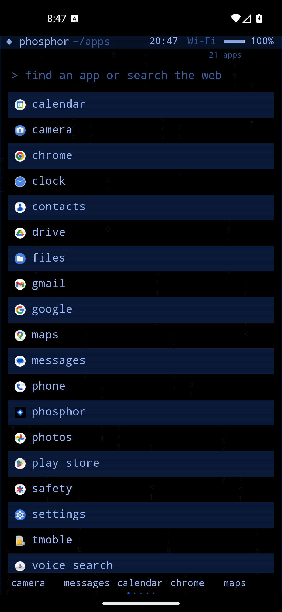

# Phosphor Demake

Неофициальный Android-лаунчер в терминальном CRT-стиле, вдохновлённый [Phosphor](https://phosphor.zanoski.com/). Нативный интерфейс на Kotlin / Android Canvas, настраиваемые страницы и офлайн-арт из [ascii.rest](https://ascii.rest/).

**[Скачать APK](https://github.com/Arkuda/phosphor_demake/releases/latest/download/app-debug.apk)** · [Все релизы](https://github.com/Arkuda/phosphor_demake/releases) · [История изменений](CHANGELOG.md)

## Скриншоты

<p align="center">
  
  
  
</p>

Снимки работающего приложения в Android-эмуляторе, не макеты. Демонстрационные события записаны в настоящий календарь эмулятора; погода Самары получена с сервера.

## Возможности

- Блочные часы, секунды, CRT-свечение, скан-линии и анимированный фон; 14 цветовых тем.
- До 10 настраиваемых страниц: dashboard, погода, уведомления, системный монитор, Zen, art, календарь, медиа и инструменты.
- Список установленных приложений с иконками размером с текст, инерционной прокруткой, поиском с поддержкой опечаток и запуском приложений.
- Пять упорядоченных позиций нижнего бара: выбор приложения для каждой позиции, пустые позиции, перестановка без дубликатов и сохранение настроек.
- Ближайшие события календаря на главной и общий виджет на существующей странице **agenda**: текущие, будущие и события на весь день; завершённые, отменённые и скрытые события не показываются.
- Погода Open-Meteo с резервным источником **wttr.in** при недоступности сервера прогноза; кириллический поиск города, уточнение страны, трёхдневный прогноз и локальный кэш.
- Реальные показатели батареи, памяти, хранилища и сетевого трафика; быстрые системные действия.
- Необязательный доступ к уведомлениям, календарю и управлению медиа.
- Задачи, заметки, калькулятор, Pomodoro с фоновыми сигналами, мировые часы и другие инструменты.
- **217 работ ascii.rest 0.4.0 внутри APK:** категории, поиск, оригинальные цвета или палитра лаунчера, пауза. Отдельная страница art и замена пейзажа на Zen. Интернет для арта не нужен.
- Живые обои для домашнего экрана / экрана блокировки через системный выбор Android.

## Установка и управление

1. Скачайте APK из [Releases](https://github.com/Arkuda/phosphor_demake/releases/latest) и разрешите установку из выбранного источника. Публикуемый APK — debug-сборка.
2. Откройте Phosphor → **◆ phosphor → set default launcher**, чтобы назначить его домашним экраном.
3. При необходимости включите доступ в **optional permissions** и настройте город в **weather / location**. Эти разрешения не обязательны для запуска лаунчера.

Жесты: **вверх** — приложения, **вниз** — системная шторка, **влево / вправо** — страницы. Долгое нажатие на свободную область открывает редактирование страниц; на приложение — закрепление, информацию и удаление.

Нижний бар: **◆ phosphor → dock apps** → позиция → приложение или **empty · remove app**. Долгое нажатие на позицию открывает тот же выбор. Если выбранное приложение уже есть в баре, позиции меняются местами; удалённое приложение оставляет пустую позицию. **reset to defaults** восстанавливает начальный набор.

События: разрешите чтение календаря в **optional permissions → calendar events** или прямо в виджете. **all ›** на главной и **◆ phosphor → calendar events** открывают существующий экран **agenda**; его также можно выбрать в редакторе страниц. Уведомления остаются на отдельной странице **inbox**.

Погода для Самары: **◆ phosphor → weather / location → choose city** → `Самара, РФ`, `Самара, RU` или `Samara, RU`. Геокодирование учитывает язык ввода и страну; используется часовой пояс выбранного города, для Самары — `Europe/Samara`. Название источника видно в виджете. При переходе на wttr.in график показывает исходные трёхчасовые точки ближайших 24 часов, без выдуманной почасовой интерполяции.

Арт: **◆ phosphor → ASCII art**. Выберите **browse catalogue**, **open art page** или переключите **Zen scene**. Страницу art также можно добавить через редактор страниц.

Для композиции экрана блокировки выберите компактные системные часы в настройках Android. Приложение не может перемещать или заменять часы, нарисованные самой системой; большие двухстрочные часы могут перекрывать живые обои.

## Требования и сборка

- Android **8.0 / API 26+**; для арта — актуальный Android System WebView.
- Для сборки: **JDK 17**, Android SDK Platform **35**. Укажите SDK через `ANDROID_HOME` или локальный `local.properties` с `sdk.dir`.

Windows:

```powershell
.\gradlew.bat :app:assembleDebug
```

Linux / macOS:

```sh
./gradlew :app:assembleDebug
```

APK: `app/build/outputs/apk/debug/app-debug.apk`.

Готовые арт-ресурсы уже включены в исходники: Node.js для обычной Android-сборки не требуется. Для их повторной генерации нужен Node.js **22.18+**:

```sh
npm ci --ignore-scripts
npm run build:ascii
```

## Проверка и ограничения

Версия **1.2** собрана и проверена на Android 16 / API 36: реальные записи CalendarProvider, исключение завершённых/отменённых/скрытых событий, общий виджет на главной и agenda, необязательное разрешение календаря, инерция после отпускания пальца и остановка новым тапом, сброс при поиске, иконки, настройка/перестановка/сохранение пустых позиций дока, миграция старых закреплений и удаление выбранного приложения. Проверены 1080×2340 и 720×1280 с XL-текстом.

Для ввода **«Самара, РФ»** приложение получило живой прогноз wttr.in с правильными координатами и часовым поясом `Europe/Samara`, когда сервер Open-Meteo не отвечал. Доступность сервисов зависит от сети; при отсутствии обоих источников приложение не подставляет демонстрационную погоду. Физические устройства, сети российских операторов и ограничения конкретных производителей не проверялись. История проверки арта 1.1 — в [CHANGELOG.md](CHANGELOG.md).

Системные переключатели, точные будильники и экран блокировки ограничены доступными Android API и разрешениями.

## Приватность и авторство

Нет аккаунтов, рекламы и аналитики. Приложения, заметки, задачи, календарь и уведомления обрабатываются локально. Только настроенная погода отправляет название города в геокодирование Open-Meteo и координаты в его API прогноза; при недоступности сервера прогноза координаты отправляются в [wttr.in](https://github.com/chubin/wttr.in#json-output). Координаты местоположения устройства округляются до двух знаков. Арт работает с локальными ресурсами, без загрузки сайта или CDN.

Это независимая реализация, не оригинальное приложение Phosphor и не проект его автора. Пиксель-в-пиксель соответствие закрытому оригиналу не заявляется.

Работы и рендерер **ascii.rest** созданы [@bas3line](https://github.com/bas3line) и распространяются по MIT. Исходный текст лицензии сохранён в [app/src/main/assets/ascii/LICENSE](app/src/main/assets/ascii/LICENSE) и доступен в приложении через **ASCII art → MIT license**. Каталог зафиксирован на опубликованном пакете 0.4.0; более новый каталог на сайте может отличаться.
